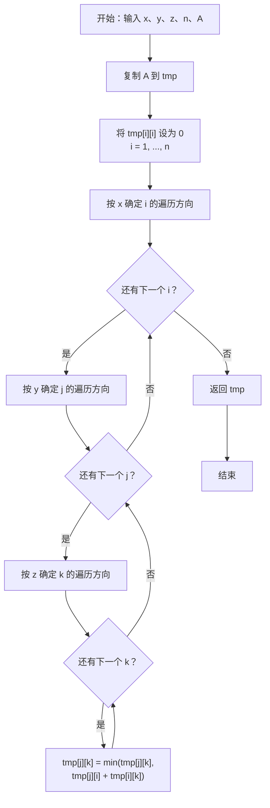

正在对 Floyd 进行全面的研究。

<!--more-->

对于一个**有负环**、无重边、无自环的有向图，设 $A$ 为其邻接矩阵表示，即 $A_{u,v}=w(u,v)$（$(u,v)\in E$）或 $A_{u,v}=+\infty$（$(u,v)\notin E$），设 $n$ 为图的点数。

令 $f(x,y,z)$ 表示以下伪代码（`python`）的执行结果：

```python
def f(x:bool,y:bool,z:bool,n:int,A:list[list]):
    tmp=[r[:]for r in A]
    for i in range(1,n+1):
        tmp[i][i]=0
    for i in (range(1,n+1,1) if x==0 else range(n,0,-1)):
        for j in (range(1,n+1,1) if y==0 else range(n,0,-1)):
            for k in (range(1,n+1,1) if z==0 else range(n,0,-1)):
                tmp[j][k]=min(tmp[j][k],tmp[j][i]+tmp[i][k]) # Floyd i,j,k
    return tmp
```



求出所有 $(x_0,y_0,z_0,x_1,y_1,z_1)$（$[x_0,y_0,z_0]\neq[x_1,y_1,z_1]$），使得对于 $\forall A$（要求对应的图满足上述条件）满足 $f(x_0,y_0,z_0)\neq f(x_1,y_1,z_1)$。

目前猜想，仅有以下四组不满足条件：

```plaintext
0,0,1, 1,0,1
1,0,1, 0,0,1
0,1,0, 1,1,0
1,1,0, 0,1,0
```